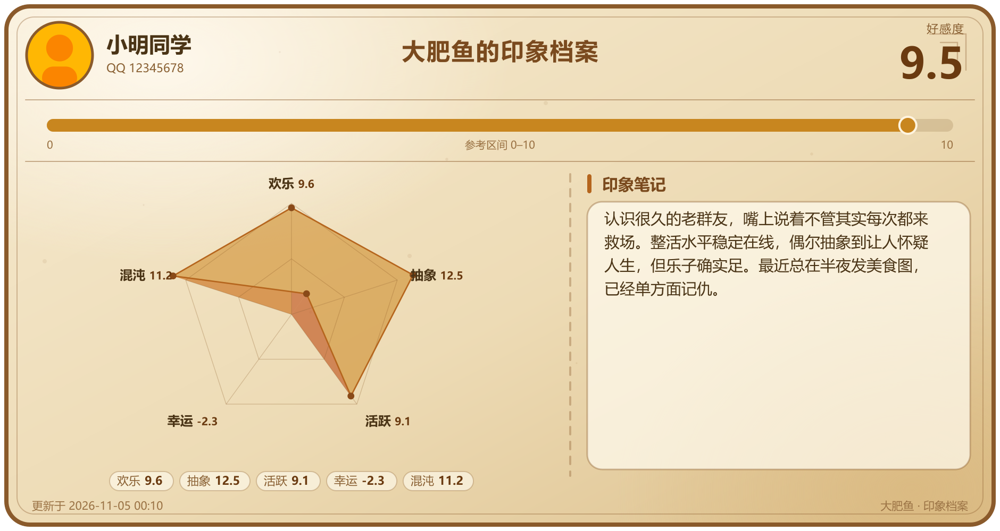

# 印象卡片

Aurabot 用户扩展。移植自 MaiBot 插件 [maibot-impression-card-plugin](https://github.com/yufei-pan/maibot-impression-card-plugin)（作者 kes，MIT）：给群友一张欢乐向的好感度 / 印象卡 —— 顶部头像、昵称与好感度，中间一条横向量表条，下面左边多维雷达、右边人物印象笔记。数值没有上下限：负分会穿过圆心，超过量程会顶出外环。

> 仓库：[独立仓库](https://github.com/cdcp998/impression-card) · [模块市场](https://github.com/aureth-labs/dsh-aurabot-qq-mods) · 其他模块：[讨饭](https://github.com/cdcp998/beg-for-money)、[价格监控](https://github.com/cdcp998/price-watch)

> 这是一个 meme 向的设定，不必太当真。



## 能做什么

- **`/卡片`**（主人；群友也可以直接发）：生成并发送一张印象卡。
- **不用打斜杠**：消息里说「查询好感度」或「查询好感度 小明」也会直接发卡（主人、群友都可以，受同样的权限和冷却约束）。
  - `/卡片` 看自己；`/卡片 @某人`、`/卡片 名字`、`/卡片 QQ号` 看别人（可在设置里关掉）。
  - 可加 `雷达:N`（`radar:` / `雷达数:` / `top_n:` 也行）指定雷达图显示几个维度，省略用设置里的值。
- **`/刷新印象`**：结合记忆与最近聊天重新评估某人，再发卡。默认只有管理员能用（`refreshAdminOnly`），`/卡片` 不受限。
- **`/印象列表`**：现有档案一览。
- **`/印象卡片帮助`**：命令与雷达用法。
- 她自己的工具：

  | 工具 | 作用 |
  | --- | --- |
  | `impression_adjust` | 给某人某项加 / 减分（可负），按设置发【系统通知】 |
  | `impression_set` | 直接把某项设为指定值（重置 / 校准） |
  | `impression_append_note` | 追加人物印象笔记 |
  | `impression_rewrite_note` | 覆盖人物印象笔记 |
  | `impression_detail` | 用文字返回完整档案（没有档案会先冷启动） |
  | `impression_nudge` | 用较小的近期聊天做增量微调（deltas），后台完成 |
  | `impression_refresh` | 结合记忆 + 最近聊天全面重算 |
  | `impression_send_card` | 向当前聊天主动发卡（可 `refresh_first`、`radar_top_n`） |

  `target` 可以传 QQ 号、昵称、群名片或别名，不传就是当前说话的人；`dimension` 传 `total`（独立的好感度）或维度 key。

- **面板**：设置和面板是扩展自己的独立页「印象卡片」，落在主面板默认的「系统」分组里（不写 `tab` / `group`，不会塞进内置页）。里面是档案列表、搜索、卡片预览、维度条、加减分、刷新、删除、最近变动。列表最多显示最近更新的 500 个档案（数据本身没有这个上限）。

## 数值与维度

- **好感度（total）**始终存在、独立加减，用顶部数字 + 横向量表条展示，可以越界。
- **子项维度**默认 22 项（对齐大阿尔卡纳）：熟悉、信赖、欢乐、省心、贴贴、抽象、含金量、合拍、安心、慷慨、智力、魅力、活跃、幸运、混沌、中二、缘分、直觉、不羁、神秘、虔诚、希望。全部是正向表述：加分=认可，扣分=不满。
- 设置里用一行一个 `key = 标签 | 描述` 增删改；留空用内置 22 项。改标签、调顺序不会丢数据，改 key 等于新维度。
- `scaleMin` / `scaleMax` 只影响显示刻度和配色；`defaultScore` 是未评分、新增维度、冷启动的起点。
- 雷达图默认取得分最高的 N 项；如果有负分，改成最高 N−1 项 + 最低 1 项（和原插件一致），让「凹进去」的那一项也看得见。

## 卡片

三套内置主题：`parchment` 羊皮纸、`holo` 全息科技、`cute` 可爱贴纸。卡面是纯 SVG，由 **DSH 自带的 sharp（libvips）** 栅格化，不装 Playwright / Pillow，也不需要联网字体 —— 中文用系统字体（Microsoft YaHei / PingFang SC / Noto Sans SC 依次兜底）。

- 输出 PNG（默认）或 JPEG；渲染倍率 1x / **2x（默认）** / 3x。
- 只有头像会联网：固定请求 `https://q1.qlogo.cn/g?b=qq&nk=<QQ号>&s=640`，QQ 号必须通过纯数字校验，URL 的协议 / 主机 / 路径全部硬编码，不接受外部链接。`fetchAvatar=false` 时完全离线，卡面用占位头像。
- sharp 实在不可用时不会假装成功：降级发一条文字版卡片摘要，日志里说明原因；面板会提示「图片渲染不可用」并说明只用 DSH 自带的那份（见下）。

## 印象笔记

- `noteSizeLimit`（默认 256 字符）是**卡面**显示上限。持久笔记开启时，库里的笔记可以更长；发卡时超长会临时用模型精简，**不改库**。
- `persistentNote` 关闭时，以卡面上限为准，写入 / 发卡时超长直接精简或截断。
- 笔记精简、冷启动、刷新、微调都走 `api.ask`（不占会话、不带人格记忆，人格文本由提示词注入），失败时保留原档案，不会把分数写坏。

## 安装

需要 Aurabot 1.2.0 或更高版本（用户模块接口 1）。在 Aurabot 面板「扩展 → 模块市场」里搜「印象卡片」安装即可，不用装 Node.js，也不用执行安装命令。

本地开发时在仓库里跑模块测试：

```sh
cd modules/impression-card
npm test
```

安装后在 Aurabot 面板「扩展」里重新加载 `impression-card`——它会在主面板「系统」分组里单独占一页「印象卡片」。数据（`affinity.json`、`cards/`）在 `modules-data/impression-card/`，升级代码不会清掉。

## 没有 sharp 时

卡片渲染用 DSH 自带的 sharp（libvips）。模块只读这份，不会在运行时装 npm 包。DSH 版本较老、精简安装或原生库加载失败时：

- 面板「系统 → 印象卡片」会明确显示「卡片图渲染不出来」，不假装成功；
- QQ 里发 `/卡片` 会降级成文字版卡片摘要；
- 想恢复图卡，升级 DSH 到一个自带 sharp 的版本即可。

## 设置

设置都在模块的自动表单里（面板底部）。挑几个关键的：

| 设置 | 默认 | 说明 |
| --- | --- | --- |
| `enabled` | 开 | 总开关；关掉后命令、工具、提醒都停，档案保留 |
| `dimensions` | 空 | 维度配置，空 = 内置 22 项 |
| `theme` / `cardFormat` / `cardScale` | parchment / png / 2 | 卡面外观 |
| `allowQueryOthers` | 开 | 关掉后只能看自己的卡 |
| `guestCards` | 开 | 关掉后只有主人能用 /卡片 |
| `guestColdStart` | 关 | 群友查一个没有档案的人时，是否允许触发模型生成 |
| `refreshAdminOnly` | 开 | `/刷新印象` 是否仅管理员；主人 QQ 自动算管理员 |
| `noteSizeLimit` / `persistentNote` | 256 / 开 | 笔记显示与存储策略 |
| `notifyEnabled` / `notifyDimensions` | 开 / total | 【系统通知】开关与播报范围（`*` = 全部） |
| `lightRefresh` | 关 | 发卡前先用较短窗口的聊天做一次 deltas 微调 |
| `proactiveEnabled` | 关 | 后台定时小幅微调，见下 |
| `contextEnabled` | 开 | 每轮聊天前把当前说话人的印象摘要塞给她 |

## 群友怎么查卡

Aurabot 的 `api.command` 只对主人开放，所以群友的 `/卡片` 是扩展在 `message` 事件里接管的（返回 `true` 就这条不再交给模型）。规则：

- 只认以 `/` 或 `／` 开头的 `/卡片`、`/card`、`/印象卡片`，不做模糊匹配，避免误伤聊天。
- `guestCards` 关掉后一律不管；`allowQueryOthers` 关掉后群友只能查自己。
- 群友查一个**没有档案**的人默认不触发模型（`guestColdStart=false`），避免被别人刷额度；打开后每人每天最多 6 次冷启动。主人查卡不受这个限制。
- 每个聊天 + 用户 8 秒冷却，防止连点。
- 查不到人、同名多人、没有档案都会明说原因，不会瞎猜一个人发卡。

## 主动微调（默认关）

打开后每隔 `proactiveHours`（默认 6 小时）对最近活跃的聊天做一次检查，从聊天流水里挑最近说过话、**已经有档案**的人，用较小窗口的聊天做一次 deltas 微调，最多 `proactiveMaxPerTick` 个聊天 × 每人 1 次。

- 只改分数和笔记，**不会自己往群里说话**，也不会发系统通知。
- 只读本机聊天流水（`hub.chatLogOf`）和已有档案，没有新聊天就跳过。
- 关掉总开关或模块停用后立刻停；每轮都会重新读设置。

## 和参考插件的差异

| 参考插件（MaiBot） | 这里（Aurabot） |
| --- | --- |
| Playwright + Pillow 渲染 HTML 模板 | 纯 SVG + DSH 自带 sharp 栅格化；头像动图只取首帧 |
| SQLite（`data/affinity.sqlite3`） | `affinity.json`（原子写入，坏文件自动备份成 `.broken`） |
| `PersonInfo` + `knowledge.search` 取长期记忆 | 读 Aurabot 记忆模块的 `recall()` / `profiles()`，没有时退化为最近聊天 |
| 命令 / 工具由 MaiBot 调度 | 主人用 `api.command`，群友的 `/卡片` 由 `message` 事件接管 |
| `maisaka.proactive.trigger` 唤醒规划器 | 直接做后台 deltas 微调，不触发发言 |
| 动图卡片（多帧头像合成） | 静态图（PNG/JPEG）；动图头像取首帧 |

原插件的 `light_refresh`、`notify`、`compact` 等行为都保留了；模型调用统一走 `api.ask`，没有 task_name / temperature 这些 Host 参数，提示词里要求「只输出 JSON」，解析失败就保留原档案。

## 测试

不联网、不上 QQ、不依赖 sharp（sharp 的失败路径用假实现覆盖）：

```sh
cd modules/impression-card
npm test
```

覆盖：维度解析与雷达选取、数字格式化、档案读写与坏文件恢复、身份解析（群名片 / 昵称 / 别名 / 同名多人）、卡面三套主题、量表条越界、雷达顶点、头像 URL 白名单、提示词占位符、JSON 提取、deltas 应用与截断、面板脚本可加载。

## 安全边界

- 卡片内容来自她对群友的印象，属于她自己的输出；笔记和分数只写本机数据目录。
- 唯一的出站请求是拉 QQ 头像（固定地址 + 纯数字校验 + 8 秒超时 + 2MB 上限），失败静默回退占位头像。
- 不下载、不安装、不执行任何第三方代码；sharp 只用 DSH 自带的那份，缺了就发文字卡。
- 群友查卡只返回卡片本身；面板接口会拒绝跨站请求（`Sec-Fetch-Site: cross-site`、Origin 与 Host 不同源），并校验 Host 只接受回环 / localhost / IP 字面量或 `security.publicHostname`（防 DNS rebinding）；写接口只接受 POST。它没有额外的 token 鉴权，默认就在本机 Web GUI 里用。
- 所有 `impression_*` 工具只在主人会话里可用（`turnSendersAllOwner`：这一轮说话的人必须全是主人），群聊里别人说话的那一轮不能改分、写笔记或触发模型。
- 冷启动 / 刷新在群聊和非主人私聊里只检索当前聊天里与本人相关的记忆，不读主人私聊的全域记忆和跨聊天人物小档案；被「忘记」的聊天内容、bot 自己的发言和「看过」占位行不会进入提示词。
- `/刷新印象` 与冷启动会消耗模型额度：非主人默认不能刷新，群友冷启动默认关闭。

## License

MIT。原插件版权归 kes（https://github.com/yufei-pan/maibot-impression-card-plugin）；本移植版同样以 MIT 发布，见 `LICENSE`。
