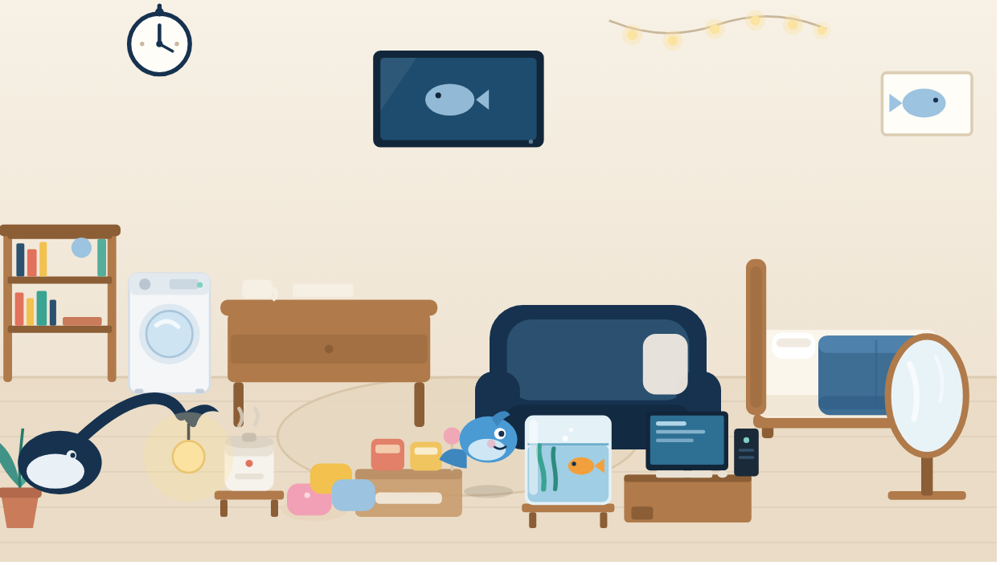

# 小鱼的小屋（room）

给她一间自己的房间：聊天攒鱼币，攒够了买家具和装饰，面板里拖着随便摆。屋子会跟着她的心情变亮或变暗。

## 玩法

- **聊天里**：`/房间`（或 `/小屋`）看余额和家当；`/买 木桌` 直接买；主人可以 `/给币 100`。
- **面板里**：Aurabot 面板 → 扩展 → 小鱼的小屋。点商店里的家具买，按住家具拖到想要的位置，右上角「一键布置」回到默认摆法。
- **攒币**：每收到一条消息 +1 鱼币，每天封顶 60（都能改）。她也会自己用 `room_buy` 买、用 `room_move` 挪。
- **心情联动**：心情低于 55 分，屋里会暗下来（最多暗 45%），鲸鱼台灯的灯泡从暖黄转冷蓝，零食箱变淡；心情越好灯越亮。

## 房间里的小鱼

她自己也在屋里——一条蓝色的小鱼，站在地板上，能跟着鼠标拖来拖去。

- 她不是家具，**不占商店、不能卖**，也不花鱼币；第一次运行时自动出现在房间里。
- 心情好（>55）的时候她在笑，心情差的时候嘴是一条直线。
- 心情 < 55 的时候整间屋子会暗下来，这条规则对她也一样。

## 家具

| 家具 | 价格（鱼币） | 摆在哪 |
|---|---|---|
| 小鱼画 | 20 | 墙上 |
| 抱枕堆 | 20 | 地上 |
| 盆栽 | 25 | 地上 |
| 一箱零食 | 30 | 地上 |
| 地毯 | 40 | 地面（永远垫在最底下） |
| 挂钟 | 40 | 墙上 |
| 星星串灯 | 45 | 墙上 |
| 电饭煲 | 60 | 地上（一直保温着，还冒热气） |
| 落地镜 | 70 | 地上 |
| 木桌 | 80 | 地上 |
| 鲸鱼台灯 | 90 | 地上（尾巴当灯臂） |
| 小鱼缸 | 95 | 地上（缸里有条橙色小鱼） |
| 书架 | 110 | 地上（三格，塞满了书） |
| 深蓝沙发椅 | 120 | 地上 |
| 床 | 150 | 地上（深蓝毯子） |
| 电视 | 160 | 墙上（屏幕里老是那条鱼） |
| 洗衣机 | 170 | 地上（滚筒门能看见水） |
| 电脑 | 200 | 地上（显示器+主机+键盘一整套） |

共 18 件。挂墙的四件（小鱼画、挂钟、星星串灯、电视）默认贴在墙上，不占地面。

起手 320 币，够买一套基础款。卖回去按六折。

「一键布置」会把**已经买的**家具挪回标准位置；还没买的，只有那 8 件基础款（地毯、木桌、沙发椅、台灯、床、零食、小鱼画、盆栽）会在钱够时顺手买一件——装饰件不会自动花钱，得你自己买。

## 配置

面板 → 扩展 → 小鱼的小屋 → 设置：

| 项 | 默认 | 说明 |
|---|---|---|
| 货币名字 | 鱼币 | 改成「积分」「小鱼干」都行 |
| 初始余额 | 320 | 第一次运行时给她多少 |
| 每聊一句加多少 | 1 | 0 就是只能靠 `/给币` |
| 每天最多挣多少 | 60 | 防止刷币 |

## 命令和工具

| 名称 | 谁可以用 | 做什么 |
|---|---|---|
| `/房间`、`/小屋` | 所有人 | 报余额、家当和今日已挣 |
| `/买 <名字>` | 所有人 | 买一件家具 |
| `/给币 <数量>` | 主人 | 给她加鱼币 |
| `room_status` | 她 | 查余额和家具 |
| `room_buy` | 她 | 买（参数 `name`） |
| `room_move` | 她 | 挪家具（参数 `name`、`x`、`y`，0–100 的百分比） |

## 数据和权限

- **读写**：`plugins-data/aurabot/modules-data/room/room.json`（余额、家具位置、今日已挣）。删掉这个文件就回到初始状态。
- **只读**：`plugins-data/aurabot/mood.json`，只为拿心情分数；读不到就按 70 分算。
- **联网**：不联网，不发任何请求。
- **依赖**：无。心情联动是可选加强，插件没装 `mood` 模块时自动降级成固定亮度。

## 许可证

MIT
